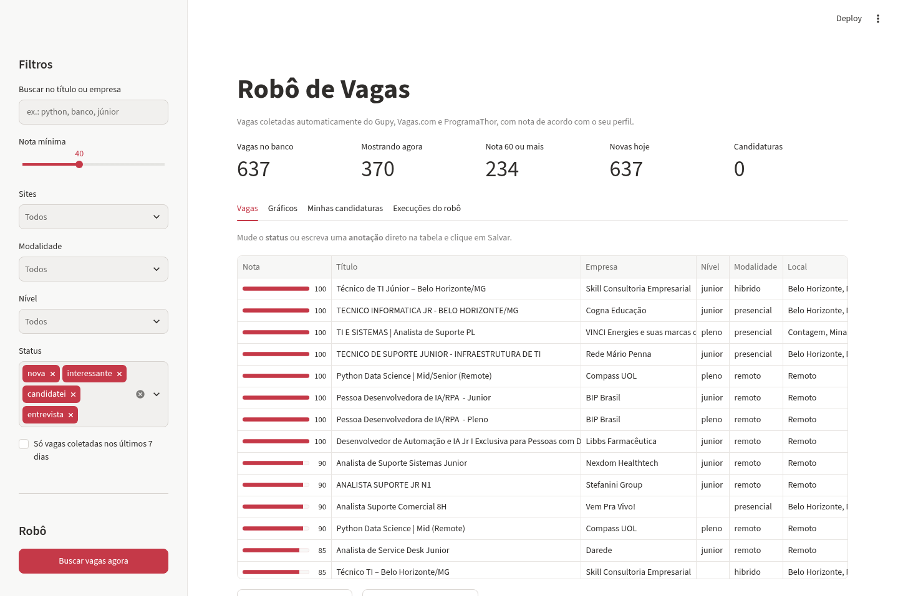
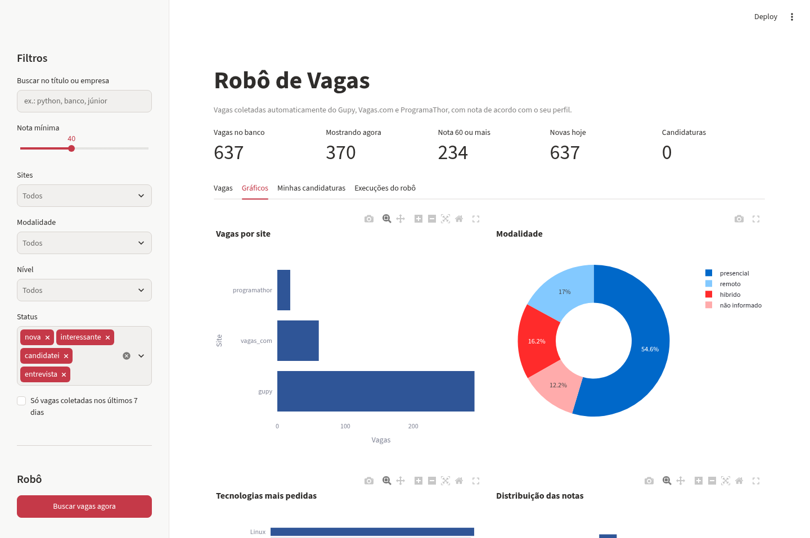

# Robô de Vagas

Sistema em Python que procura vagas de emprego sozinho em vários sites, dá uma nota pra cada vaga de acordo com o seu perfil, guarda tudo num banco de dados e avisa por e-mail ou Telegram quando aparece uma vaga boa. Também tem um painel web pra filtrar as vagas, ver gráficos e acompanhar as suas candidaturas.





## Funcionalidades

- **Coleta em 4 sites, com técnicas diferentes**
  | Site | Técnica |
  |---|---|
  | Gupy | API JSON com `requests` |
  | Vagas.com | Navegador automatizado com Selenium (RPA): clica em "mostrar mais vagas" e lê os cartões |
  | ProgramaThor | Leitura do HTML com BeautifulSoup |
  | Sólides Vagas | API JSON com `requests`, filtrando pelas suas cidades e pegando as vagas remotas |
- **Nota de 0 a 100** pra cada vaga, baseada nas suas habilidades, no nível (estágio, júnior...) e no local. Cada nota mostra os motivos, ex.: `+45 habilidades: python, sql, automação`
- **Banco de dados SQLite**: não repete vagas e guarda o histórico de cada execução
- **Painel web (Streamlit)** com filtros, gráficos, detalhes da vaga e controle de candidaturas (nova, interessante, candidatei, entrevista, descartada)
- **Relatório em Excel** com links clicáveis, cores por nota, resumo e gráficos
- **Alertas por e-mail e Telegram** só das vagas novas com nota alta, sem repetir aviso
- **Agendamento** pra rodar sozinho todo dia
- **Testes automáticos** (pytest) rodando no GitHub Actions
- **Docker** pra rodar em qualquer máquina

## Tecnologias

Python 3.12+ · Selenium · requests · BeautifulSoup · SQLite · pandas · Streamlit · Plotly · openpyxl · pytest · Docker · GitHub Actions

## Como usar

### 1. Instalar
```bash
git clone https://github.com/LuizOttario/robo-vagas.git
cd robo-vagas
python -m venv .venv
source .venv/bin/activate        # no Windows: .venv\Scripts\activate
pip install -r requirements.txt
```
Precisa ter o Google Chrome instalado (usado no Vagas.com).

### 2. Configurar o seu perfil
```bash
cp config.exemplo.toml config.toml
```
No `config.toml` você escolhe os termos de busca, as suas habilidades, o nível e as cidades, e liga o e-mail ou o Telegram se quiser receber avisos.

### 3. Rodar
```bash
python -m vagas coletar            # busca vagas novas
python -m vagas painel             # abre o painel em http://localhost:8501
python -m vagas relatorio          # gera o Excel em relatorios/
python -m vagas repontuar          # recalcula as notas depois de mudar o perfil
python -m vagas status gupy:123 candidatei   # muda o status de uma vaga
```

Opções úteis do `coletar`:
```bash
python -m vagas coletar --fontes gupy programathor   # só alguns sites
python -m vagas coletar --termos "analista de dados"  # outros termos
python -m vagas coletar --ver                         # mostra o Chrome trabalhando
```

### 4. Rodar sozinho todo dia (Linux)
```bash
./agendar.sh             # às 9h e às 18h
./agendar.sh "8,13,20"   # nos horários que você quiser
./agendar.sh remover
```

### Com Docker
```bash
cp config.exemplo.toml config.toml
docker compose up -d painel        # painel em http://localhost:8501
docker compose run --rm robo       # faz uma coleta
```

## Como a nota é calculada

| Critério | Pontos |
|---|---|
| Habilidades suas que aparecem na vaga (3 ou mais = máximo) | até 45 |
| Nível desejado / não informado / a evitar | +30 / +15 / -30 |
| Remoto, ou na sua cidade / local não informado | +25 / +12 |
| Publicada nos últimos 7 dias | +5 |
| Cada palavra que você quer evitar | -15 |

## Estrutura

```
vagas/
  coletores/
    base.py           classe base de todos os coletores
    gupy.py           API do Gupy
    vagas_com.py      Selenium no Vagas.com
    programathor.py   BeautifulSoup no ProgramaThor
    solides.py        API da Sólides Vagas
  modelos.py          classe Vaga e detecção de nível e modalidade
  pontuacao.py        cálculo da nota
  banco.py            banco de dados SQLite
  relatorio.py        relatório em Excel
  notificacao.py      e-mail e Telegram
  config.py           leitura do config.toml
  __main__.py         comandos de linha de comando
painel.py             painel web
tests/                testes automáticos
```

## Testes
```bash
python -m pytest -v
```

## Adicionar um site novo

Crie um arquivo em `vagas/coletores/` com uma classe que herda de `Coletor` e implementa `coletar_termo(termo, limite)`, devolvendo uma lista de `Vaga`. Depois registre a classe em `vagas/coletores/__init__.py`.

## Aviso

O projeto faz poucas requisições, com pausa entre as páginas, e só lê informações públicas. Use com moderação e respeite os termos de uso de cada site.
